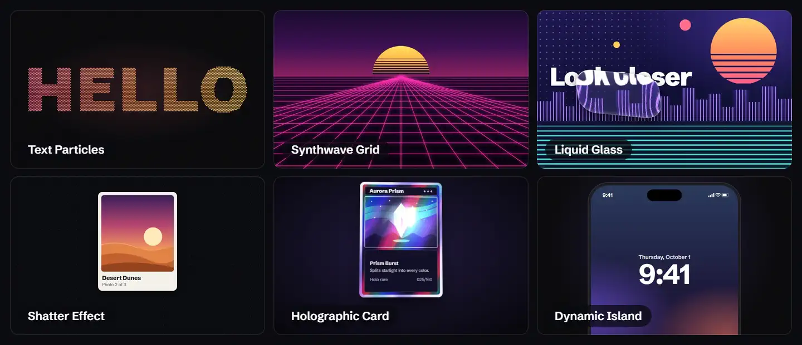
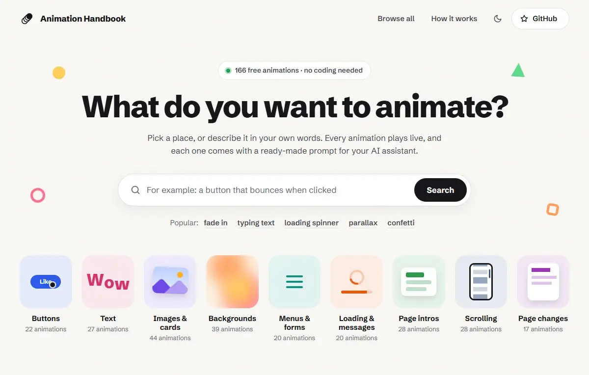

<div align="center">

<a href="https://matinmonshizadeh.github.io/animation-handbook/"><picture><source media="(prefers-reduced-motion: reduce) and (max-width: 600px)" srcset="docs/hero-phone-still.webp" width="820" height="922"><source media="(prefers-reduced-motion: reduce)" srcset="docs/hero-still.webp"><source media="(max-width: 600px)" srcset="docs/hero-phone.webp" width="820" height="922"></picture></a>

# Animation Handbook

**A visual reference of 166 web animation techniques: watch each one play live, change most of them with plain settings, and copy a ready-made prompt for your AI assistant. Free to use, with no sign-up.**

[**Open the live handbook →**](https://matinmonshizadeh.github.io/animation-handbook/)

[](https://matinmonshizadeh.github.io/animation-handbook/) [](https://github.com/matinmonshizadeh/animation-handbook) [](LICENSE) [](#full-catalog) [](#design-principles) [](#design-principles)

</div>

---

## What this is

Here are 166 web animation techniques in one place, each shown working. Every page plays its animation live and gives you a ready-made prompt to paste into your AI assistant, so you can add the animation to your own site without writing the code yourself. Most pages also let you change the animation with a few plain settings, and the prompt you copy lists your choices. Each folder's `README.md` explains how the technique works, the values that matter, and the production gotchas, for anyone who wants to build it by hand.

Everything is plain HTML, CSS, and JavaScript: no build step, no frameworks, no CDN. Open any page's `index.html` from a copy of this repository and its demo runs offline; [Run it locally](#run-it-locally) covers the parts that need a local server. Built to *inspire* and *teach*, not to sell a library.

## How to use it

1. **Find it.** On the [home page](https://matinmonshizadeh.github.io/animation-handbook/), pick where the animation goes — Buttons, Text, Images & cards, Backgrounds, Menus & forms, Loading & messages, Page intros, Scrolling, or Page changes — or describe it in your own words, like "a button that bounces when clicked".
2. **Watch it and try it.** Each page plays the animation, and most offer a few plain settings, such as speed or direction, so you see exactly what you will get.
3. **Copy the prompt.** Paste it into your AI assistant. It describes the animation in plain words, with your settings. The cards on the home page have a Copy prompt button too.

<div align="center">
<a href="https://matinmonshizadeh.github.io/animation-handbook/"><picture><source media="(prefers-reduced-motion: reduce) and (max-width: 600px)" srcset="docs/demo-phone-still.webp" width="820" height="1531"><source media="(prefers-reduced-motion: reduce)" srcset="docs/demo-still.webp"><source media="(max-width: 600px)" srcset="docs/demo-phone.webp" width="820" height="1531"></picture></a>
</div>

## Categories

| # | Category | Count |
|:--:|----------|:-----:|
| 01 | [Scroll-Based](#01) | 27 |
| 02 | [Entrance & Exit](#02) | 14 |
| 03 | [Page Transitions](#03) | 16 |
| 04 | [Micro-Interactions](#04) | 41 |
| 05 | [Text & Typography](#05) | 19 |
| 06 | [3D & Advanced](#06) | 26 |
| 07 | [Ambient & Background](#07) | 23 |

## Full catalog

All 166 techniques, each linked to its live demo.

Each technique's code and README are in its folder under [animations/](animations/).

<a id="01"></a>

### 01 · Scroll-Based · 27 techniques

<sub>Animations driven by scroll position — parallax, sticky, scrub, snap, and storytelling.</sub>

<details><summary>Browse all 27 techniques in Scroll-Based</summary>

- **[Parallax Depth-of-Field](https://matinmonshizadeh.github.io/animation-handbook/animations/01-scroll-based/parallax-depth-of-field/)** — Layers move at their own speed as the focus shifts. Best for cinematic intros.
- **[Parallax Scrolling](https://matinmonshizadeh.github.io/animation-handbook/animations/01-scroll-based/parallax-scrolling/)** — Far layers move slower than near ones as you scroll. Best for hero scenes.
- **[Reverse-Scrolling Columns](https://matinmonshizadeh.github.io/animation-handbook/animations/01-scroll-based/reverse-scrolling-columns/)** — Side columns run the opposite way to the middle one. Best for portfolios.
- **[Cover Card to Fixed Header](https://matinmonshizadeh.github.io/animation-handbook/animations/01-scroll-based/cover-card-to-fixed-header/)** — A tall cover shrinks into a slim header as you scroll. Best for articles.
- **[Fly-in Fly-out Contact List](https://matinmonshizadeh.github.io/animation-handbook/animations/01-scroll-based/fly-in-fly-out-contact-list/)** — Rows fade and slide as they near the top or bottom edge. Best for long lists.
- **[Stacking Cards](https://matinmonshizadeh.github.io/animation-handbook/animations/01-scroll-based/stacking-cards/)** — Cards stick at the top and pile into a deck. Best for step-by-step stories.
- **[Scroll-Triggered Animation](https://matinmonshizadeh.github.io/animation-handbook/animations/01-scroll-based/scroll-trigger/)** — Animations start, follow and pin at set scroll points. Best for landing pages.
- **[Scrub Animation](https://matinmonshizadeh.github.io/animation-handbook/animations/01-scroll-based/scrub-animation/)** — Scroll plays it forward and back, like dragging a video. Best for product tours.
- **[Pin Animation](https://matinmonshizadeh.github.io/animation-handbook/animations/01-scroll-based/pin-animation/)** — One part stays put while its text changes on scroll. Best for feature lists.
- **[Snap Scrolling](https://matinmonshizadeh.github.io/animation-handbook/animations/01-scroll-based/snap-scrolling/)** — The box settles on one whole section at a time. Best for slides and galleries.
- **[Scrollytelling](https://matinmonshizadeh.github.io/animation-handbook/animations/01-scroll-based/scrollytelling/)** — A picture beside the story changes as you read down. Best for data stories.
- **[Reveal on Scroll](https://matinmonshizadeh.github.io/animation-handbook/animations/01-scroll-based/reveal-on-scroll/)** — Cards appear as they cross a line in the box. Best for long landing pages.
- **[Stagger Reveal](https://matinmonshizadeh.github.io/animation-handbook/animations/01-scroll-based/stagger-reveal/)** — Items in a group appear one after another as it scrolls in. Best for card grids.
- **[Horizontal Scroll](https://matinmonshizadeh.github.io/animation-handbook/animations/01-scroll-based/horizontal-scroll/)** — Scroll down and a row of panels slides sideways. Best for portfolios.
- **[Sticky Section](https://matinmonshizadeh.github.io/animation-handbook/animations/01-scroll-based/sticky-section/)** — A section holds still while its content changes. Best for feature tours.
- **[Counter Animation](https://matinmonshizadeh.github.io/animation-handbook/animations/01-scroll-based/counter-animation/)** — Numbers count up when they scroll into view. Best for stats.
- **[Progress Bar](https://matinmonshizadeh.github.io/animation-handbook/animations/01-scroll-based/progress-bar/)** — A bar fills as you read down the page. Best for long articles.
- **[Section Wipe](https://matinmonshizadeh.github.io/animation-handbook/animations/01-scroll-based/section-wipe/)** — Each section slides up over the one before. Best for full-screen stories.
- **[Zoom Into Image](https://matinmonshizadeh.github.io/animation-handbook/animations/01-scroll-based/zoom-into-image/)** — A small window opens up to fill the box as you scroll. Best for hero images.
- **[Scroll Image Sequence](https://matinmonshizadeh.github.io/animation-handbook/animations/01-scroll-based/scroll-image-sequence/)** — Scrolling plays a series of pictures like a flip-book. Best for products.
- **[Smooth (Inertia) Scroll](https://matinmonshizadeh.github.io/animation-handbook/animations/01-scroll-based/smooth-scroll/)** — Scrolling glides to a stop instead of jumping. Best for portfolio sites.
- **[Text Fill on Scroll](https://matinmonshizadeh.github.io/animation-handbook/animations/01-scroll-based/text-fill-on-scroll/)** — Words light up one by one as you scroll. Best for key statements.
- **[Scroll Velocity Skew](https://matinmonshizadeh.github.io/animation-handbook/animations/01-scroll-based/scroll-velocity-skew/)** — Rows lean when you scroll fast and straighten when you stop. Best for galleries.
- **[SVG Line Draw on Scroll](https://matinmonshizadeh.github.io/animation-handbook/animations/01-scroll-based/svg-line-draw/)** — A line draws itself along a route as you scroll. Best for timelines.
- **[Scrollspy Navigation](https://matinmonshizadeh.github.io/animation-handbook/animations/01-scroll-based/scrollspy-nav/)** — A menu highlights the section you are reading. Best for long docs.
- **[Scroll-Driven Background Color](https://matinmonshizadeh.github.io/animation-handbook/animations/01-scroll-based/scroll-background-color/)** — The background color changes as you scroll through sections. Best for stories.
- **[Hide-on-Scroll Header](https://matinmonshizadeh.github.io/animation-handbook/animations/01-scroll-based/hide-on-scroll-header/)** — Scrolling down hides the top bar; scrolling up shows it. Best for mobile pages.

</details>

<a id="02"></a>

### 02 · Entrance & Exit · 14 techniques

<sub>Element-level animations for arriving and departing — fades, slides, reveals, flips, and text staggers.</sub>

<details><summary>Browse all 14 techniques in Entrance & Exit</summary>

- **[Fade In / Fade Out](https://matinmonshizadeh.github.io/animation-handbook/animations/02-entrance-and-exit/fade-in-out/)** — Fades in to appear and fades out to leave. Best for pop-ups and tooltips.
- **[Slide In](https://matinmonshizadeh.github.io/animation-handbook/animations/02-entrance-and-exit/slide-in/)** — Travels into place from one edge. Best for side panels and notifications.
- **[Slide Up Reveal](https://matinmonshizadeh.github.io/animation-handbook/animations/02-entrance-and-exit/slide-up-reveal/)** — Text rises into view from behind an invisible edge. Best for headlines.
- **[Scale In / Zoom In](https://matinmonshizadeh.github.io/animation-handbook/animations/02-entrance-and-exit/scale-in/)** — Grows from smaller to full size. Best for pop-ups and menus.
- **[Clip-Path Reveal](https://matinmonshizadeh.github.io/animation-handbook/animations/02-entrance-and-exit/clip-path-reveal/)** — A growing shape uncovers it while it stays still. Best for images and banners.
- **[Curtain Reveal](https://matinmonshizadeh.github.io/animation-handbook/animations/02-entrance-and-exit/curtain-reveal/)** — A colored panel covers it, then slides away. Best for intros and logos.
- **[Split Text Reveal](https://matinmonshizadeh.github.io/animation-handbook/animations/02-entrance-and-exit/split-text-reveal/)** — Text breaks into pieces that appear one after another. Best for headlines.
- **[Letter-by-Letter Stagger](https://matinmonshizadeh.github.io/animation-handbook/animations/02-entrance-and-exit/letter-by-letter-stagger/)** — A phrase appears letter by letter or typewriter-style. Best for short headlines.
- **[Word-by-Word Reveal](https://matinmonshizadeh.github.io/animation-handbook/animations/02-entrance-and-exit/word-by-word-reveal/)** — Words appear one after another at a reading pace. Best for quotes and intros.
- **[Blur In](https://matinmonshizadeh.github.io/animation-handbook/animations/02-entrance-and-exit/blur-in/)** — Comes into focus from a blur, like a camera. Best for featured cards and photos.
- **[Flip In](https://matinmonshizadeh.github.io/animation-handbook/animations/02-entrance-and-exit/flip-in/)** — Swings into view in 3D, like a card turning over. Best for cards and tiles.
- **[Bounce In](https://matinmonshizadeh.github.io/animation-handbook/animations/02-entrance-and-exit/bounce-in/)** — Lands with a springy bounce. Best for badges and success messages.
- **[Rotate In](https://matinmonshizadeh.github.io/animation-handbook/animations/02-entrance-and-exit/rotate-in/)** — Spins into place while it grows. Best for icons, stars and badges.
- **[Shatter Effect](https://matinmonshizadeh.github.io/animation-handbook/animations/02-entrance-and-exit/shatter-effect/)** — Breaks into pieces that fly apart and fade. Best for galleries and bold exits.

</details>

<a id="03"></a>

### 03 · Page Transitions · 16 techniques

<sub>Full-page transitions between routes or views — crossfades, slides, portals, morphs, and the View Transitions API.</sub>

<details><summary>Browse all 16 techniques in Page Transitions</summary>

- **[View Transitions API](https://matinmonshizadeh.github.io/animation-handbook/animations/03-page-transitions/view-transitions-api/)** — The browser animates the change between two pages for you. Best for web apps.
- **[Shared Element Transition](https://matinmonshizadeh.github.io/animation-handbook/animations/03-page-transitions/shared-element-transition/)** — A picture grows from the list into the next page's header. Best for galleries.
- **[Morph Transition](https://matinmonshizadeh.github.io/animation-handbook/animations/03-page-transitions/morph-transition/)** — The logo changes shape to match each page you visit. Best for brand marks.
- **[Crossfade Transition](https://matinmonshizadeh.github.io/animation-handbook/animations/03-page-transitions/crossfade/)** — The old page fades out as the new one fades in. Best for calm page changes.
- **[Slide Transition](https://matinmonshizadeh.github.io/animation-handbook/animations/03-page-transitions/slide-transition/)** — Pages slide across, and going back slides the other way. Best for step flows.
- **[Zoom Transition](https://matinmonshizadeh.github.io/animation-handbook/animations/03-page-transitions/zoom-transition/)** — The pages zoom as they swap, as if moving in depth. Best for opening details.
- **[Flash / Light Leak Transition](https://matinmonshizadeh.github.io/animation-handbook/animations/03-page-transitions/flash-transition/)** — A burst of light hides the moment the page changes. Best for bold, lively sites.
- **[Blur Transition](https://matinmonshizadeh.github.io/animation-handbook/animations/03-page-transitions/blur-transition/)** — The old page blurs away and the new one comes into focus. Best for photo sites.
- **[Elastic Transition](https://matinmonshizadeh.github.io/animation-handbook/animations/03-page-transitions/elastic-transition/)** — The new page slides in, goes too far and springs back. Best for playful apps.
- **[Portal / Tunnel Zoom](https://matinmonshizadeh.github.io/animation-handbook/animations/03-page-transitions/portal-zoom/)** — The next page opens out of a circle you click. Best for big reveals.
- **[Dissolve Transition](https://matinmonshizadeh.github.io/animation-handbook/animations/03-page-transitions/dissolve/)** — The page breaks into tiles that give way to the next. Best for photo galleries.
- **[FLIP Technique](https://matinmonshizadeh.github.io/animation-handbook/animations/03-page-transitions/flip-technique/)** — Cards glide to their new places when the layout changes. Best for sorting lists.
- **[Circle Reveal](https://matinmonshizadeh.github.io/animation-handbook/animations/03-page-transitions/circle-reveal/)** — Pages grow from any spot you click and shrink back into it. Best for app navigation.
- **[Overlay Wipe](https://matinmonshizadeh.github.io/animation-handbook/animations/03-page-transitions/overlay-wipe/)** — A colored panel sweeps over the page as it changes. Best for portfolio sites.
- **[Page Curl](https://matinmonshizadeh.github.io/animation-handbook/animations/03-page-transitions/page-curl/)** — The page peels back from its corner like paper. Best for digital magazines.
- **[Cube Transition](https://matinmonshizadeh.github.io/animation-handbook/animations/03-page-transitions/cube-transition/)** — The pages sit on a cube that turns to show the next. Best for photo stories.

</details>

<a id="04"></a>

### 04 · Micro-Interactions · 41 techniques

<sub>Short, user-triggered animations — hover, click, focus, loading states, and UI feedback patterns.</sub>

<details><summary>Browse all 41 techniques in Micro-Interactions</summary>

- **[Hover State Animation](https://matinmonshizadeh.github.io/animation-handbook/animations/04-micro-interactions/hover-state/)** — Six ways a card can react when you point at it. Best for buttons and cards.
- **[Click / Tap Ripple](https://matinmonshizadeh.github.io/animation-handbook/animations/04-micro-interactions/click-ripple/)** — A ripple spreads out from the spot you press. Best for buttons and list items.
- **[Focus Ring Animation](https://matinmonshizadeh.github.io/animation-handbook/animations/04-micro-interactions/focus-ring/)** — A ring closes in around the item the Tab key reaches. Best for forms and menus.
- **[Button Press Scale](https://matinmonshizadeh.github.io/animation-handbook/animations/04-micro-interactions/button-press-scale/)** — Shrinks as you press it and springs back as you let go. Best for main buttons.
- **[Magnetic Button](https://matinmonshizadeh.github.io/animation-handbook/animations/04-micro-interactions/magnetic-button/)** — Leans toward the pointer, then springs home. Best for one main button.
- **[Toggle / Switch Slide](https://matinmonshizadeh.github.io/animation-handbook/animations/04-micro-interactions/toggle-switch/)** — The knob slides across as the switch turns on or off. Best for settings.
- **[Heart / Like Burst](https://matinmonshizadeh.github.io/animation-handbook/animations/04-micro-interactions/heart-burst/)** — The heart pops and fills as small hearts burst out. Best for like buttons.
- **[Success Confetti](https://matinmonshizadeh.github.io/animation-handbook/animations/04-micro-interactions/success-confetti/)** — Confetti bursts from the button when a task is done. Best for big moments.
- **[Skeleton Loader](https://matinmonshizadeh.github.io/animation-handbook/animations/04-micro-interactions/skeleton-loader/)** — Gray shapes hold the place of content while it loads. Best for feeds and cards.
- **[Shimmer Effect](https://matinmonshizadeh.github.io/animation-handbook/animations/04-micro-interactions/shimmer-effect/)** — A band of light sweeps over gray placeholders. Best for loading screens.
- **[Loading Spinner](https://matinmonshizadeh.github.io/animation-handbook/animations/04-micro-interactions/loading-spinner/)** — Six small shapes loop to show that something is loading. Best for short waits.
- **[Progress Animation](https://matinmonshizadeh.github.io/animation-handbook/animations/04-micro-interactions/progress-animation/)** — A bar, a ring and steps fill up to show progress. Best for uploads.
- **[Checkmark Draw](https://matinmonshizadeh.github.io/animation-handbook/animations/04-micro-interactions/checkmark-draw/)** — A tick draws itself in a circle once a task succeeds. Best for forms.
- **[Form Field Morph](https://matinmonshizadeh.github.io/animation-handbook/animations/04-micro-interactions/form-field-morph/)** — The label moves up out of the way as you type. Best for sign-up forms.
- **[Notification Badge Pulse](https://matinmonshizadeh.github.io/animation-handbook/animations/04-micro-interactions/badge-pulse/)** — A badge on an icon pulses to catch the eye. Best for unread messages.
- **[Tooltip Reveal](https://matinmonshizadeh.github.io/animation-handbook/animations/04-micro-interactions/tooltip-reveal/)** — A small label fades in after a short pause. Best for icon buttons.
- **[Drawer / Panel Slide](https://matinmonshizadeh.github.io/animation-handbook/animations/04-micro-interactions/drawer-slide/)** — A side panel slides in over a dimmed page. Best for mobile menus.
- **[Modal Expand](https://matinmonshizadeh.github.io/animation-handbook/animations/04-micro-interactions/modal-expand/)** — A window grows out of the button you pressed. Best for detail views.
- **[Accordion Open/Close](https://matinmonshizadeh.github.io/animation-handbook/animations/04-micro-interactions/accordion/)** — Each question opens smoothly to show its answer. Best for FAQ pages.
- **[Cursor Follower](https://matinmonshizadeh.github.io/animation-handbook/animations/04-micro-interactions/cursor-follower/)** — A dot trails your pointer and flips the colors under it. Best for portfolios.
- **[Error Shake](https://matinmonshizadeh.github.io/animation-handbook/animations/04-micro-interactions/error-shake/)** — A field shakes side to side when the input is wrong. Best for sign-in forms.
- **[Swipe to Dismiss](https://matinmonshizadeh.github.io/animation-handbook/animations/04-micro-interactions/swipe-to-dismiss/)** — A card dragged sideways flies off and the list closes up. Best for inboxes.
- **[Hamburger Menu Toggle](https://matinmonshizadeh.github.io/animation-handbook/animations/04-micro-interactions/hamburger-menu-toggle/)** — Three lines turn into an X as the menu opens. Best for mobile menus.
- **[Theme Toggle Morph](https://matinmonshizadeh.github.io/animation-handbook/animations/04-micro-interactions/theme-toggle-morph/)** — A sun turns into a moon as the colors switch to dark. Best for theme buttons.
- **[Copy to Clipboard](https://matinmonshizadeh.github.io/animation-handbook/animations/04-micro-interactions/copy-to-clipboard/)** — Copy turns into a tick and Copied, then changes back. Best for codes and links.
- **[Star Rating](https://matinmonshizadeh.github.io/animation-handbook/animations/04-micro-interactions/star-rating/)** — Stars fill up to your pointer and pop when you choose. Best for reviews.
- **[Toast Notification](https://matinmonshizadeh.github.io/animation-handbook/animations/04-micro-interactions/toast-notification/)** — Short messages slide into a corner, then leave on their own. Best for updates.
- **[Segmented Control](https://matinmonshizadeh.github.io/animation-handbook/animations/04-micro-interactions/segmented-control/)** — A highlight slides to the option you pick. Best for switching views.
- **[Pull to Refresh](https://matinmonshizadeh.github.io/animation-handbook/animations/04-micro-interactions/pull-to-refresh/)** — Pulling a list down shows a spinner, then new items. Best for feeds.
- **[Animated Gradient Border](https://matinmonshizadeh.github.io/animation-handbook/animations/04-micro-interactions/gradient-border/)** — A band of colors runs around the edge of a card or button. Best for featured offers.
- **[Spotlight Hover Glow](https://matinmonshizadeh.github.io/animation-handbook/animations/04-micro-interactions/spotlight-hover/)** — A soft glow follows the pointer and lights card edges. Best for feature grids.
- **[Add-to-Cart Fly](https://matinmonshizadeh.github.io/animation-handbook/animations/04-micro-interactions/add-to-cart-fly/)** — The product flies into the cart, which bumps and counts up. Best for shops.
- **[Drag to Reorder](https://matinmonshizadeh.github.io/animation-handbook/animations/04-micro-interactions/drag-to-reorder/)** — Drag an item and the others slide aside to make room. Best for to-do lists.
- **[Rolling Numbers](https://matinmonshizadeh.github.io/animation-handbook/animations/04-micro-interactions/rolling-numbers/)** — Each digit rolls to its new value, like a mileage counter. Best for prices.
- **[Typing Indicator](https://matinmonshizadeh.github.io/animation-handbook/animations/04-micro-interactions/typing-indicator/)** — Three dots in a chat bubble move in turn while someone types. Best for chat apps.
- **[Hold to Confirm](https://matinmonshizadeh.github.io/animation-handbook/animations/04-micro-interactions/hold-to-confirm/)** — A button fills up while you hold it and acts only once it is full. Best for delete buttons.
- **[Expanding Search](https://matinmonshizadeh.github.io/animation-handbook/animations/04-micro-interactions/expanding-search/)** — A search icon opens into a field, then closes when done. Best for toolbars.
- **[Button Loading States](https://matinmonshizadeh.github.io/animation-handbook/animations/04-micro-interactions/button-loading-states/)** — The button becomes a spinner, then a tick or a cross. Best for Save buttons.
- **[Image Trail](https://matinmonshizadeh.github.io/animation-handbook/animations/04-micro-interactions/image-trail/)** — Pictures pop up in a trail behind your pointer, then fade. Best for portfolios.
- **[Gooey Menu](https://matinmonshizadeh.github.io/animation-handbook/animations/04-micro-interactions/gooey-menu/)** — Small buttons ooze out of a round button like liquid. Best for quick actions.
- **[Dynamic Island](https://matinmonshizadeh.github.io/animation-handbook/animations/04-micro-interactions/dynamic-island/)** — A black pill grows into a notification, then shrinks back. Best for live updates.

</details>

<a id="05"></a>

### 05 · Text & Typography · 19 techniques

<sub>Animations specifically for type — kinetic motion, character-level effects, gradient flows, and word transformations.</sub>

<details><summary>Browse all 19 techniques in Text & Typography</summary>

- **[Kinetic Typography](https://matinmonshizadeh.github.io/animation-handbook/animations/05-text-typography/kinetic-typography/)** — Words arrive and leave one by one, each moving its own way. Best for intros.
- **[Typewriter Effect](https://matinmonshizadeh.github.io/animation-handbook/animations/05-text-typography/typewriter-effect/)** — Text types itself out behind a blinking cursor. Best for short taglines.
- **[Scramble / Glitch Text](https://matinmonshizadeh.github.io/animation-handbook/animations/05-text-typography/scramble-text/)** — Random symbols lock into the real text, left to right. Best for tech headlines.
- **[Variable Font Morph](https://matinmonshizadeh.github.io/animation-handbook/animations/05-text-typography/variable-font-morph/)** — A word smoothly turns bold, then light, and leans over. Best for headlines.
- **[Text Clip-Path Reveal](https://matinmonshizadeh.github.io/animation-handbook/animations/05-text-typography/text-clip-path-reveal/)** — Each line of a headline is uncovered in turn. Best for big headlines.
- **[Marquee / Ticker](https://matinmonshizadeh.github.io/animation-handbook/animations/05-text-typography/marquee-ticker/)** — Text scrolls sideways in an endless loop, with no seam. Best for news tickers.
- **[Text Morphing](https://matinmonshizadeh.github.io/animation-handbook/animations/05-text-typography/text-morphing/)** — One word changes into the next, letter by letter. Best for short labels.
- **[Text Gradient Animation](https://matinmonshizadeh.github.io/animation-handbook/animations/05-text-typography/text-gradient-animation/)** — Colors flow through the letters while the text stays still. Best for headlines.
- **[Outline to Fill](https://matinmonshizadeh.github.io/animation-handbook/animations/05-text-typography/outline-to-fill/)** — Hollow letters fill with color, as a wipe or a fade. Best for big headlines.
- **[Enter/Exit Typography](https://matinmonshizadeh.github.io/animation-handbook/animations/05-text-typography/enter-exit-typography/)** — Each phrase comes in, stays long enough to read, then leaves. Best for slogans.
- **[Rotate Word Carousel](https://matinmonshizadeh.github.io/animation-handbook/animations/05-text-typography/rotate-word-carousel/)** — One word in a sentence keeps swapping for the next. Best for hero headlines.
- **[Glitch Text](https://matinmonshizadeh.github.io/animation-handbook/animations/05-text-typography/glitch-text/)** — Text tears into red and cyan strips like a broken signal. Best for bold titles.
- **[Text on a Path](https://matinmonshizadeh.github.io/animation-handbook/animations/05-text-typography/text-on-path/)** — Text travels along a wave, an arc or a circle. Best for badges and seals.
- **[Wavy Text](https://matinmonshizadeh.github.io/animation-handbook/animations/05-text-typography/wavy-text/)** — A wave rolls through the word, letter by letter. Best for playful titles.
- **[Highlighter Sweep](https://matinmonshizadeh.github.io/animation-handbook/animations/05-text-typography/highlighter-sweep/)** — A marker sweeps in behind the key words, one after another. Best for key points.
- **[Split-Flap Board](https://matinmonshizadeh.github.io/animation-handbook/animations/05-text-typography/split-flap-board/)** — Tiles flip through the letters to spell a word, like an airport board. Best for hero titles.
- **[Neon Flicker](https://matinmonshizadeh.github.io/animation-handbook/animations/05-text-typography/neon-flicker/)** — Glowing letters sputter now and then, like a worn neon sign. Best for night themes.
- **[Handwriting Draw](https://matinmonshizadeh.github.io/animation-handbook/animations/05-text-typography/handwriting-draw/)** — A word writes itself stroke by stroke, as if by a pen. Best for greetings and signatures.
- **[Text Particles](https://matinmonshizadeh.github.io/animation-handbook/animations/05-text-typography/text-particles/)** — A word of dots scatters from your pointer and springs back. Best for intros.

</details>

<a id="06"></a>

### 06 · 3D & Advanced · 26 techniques

<sub>WebGL, shaders, particles, 3D transforms, simulations, and other heavier effects.</sub>

<details><summary>Browse all 26 techniques in 3D & Advanced</summary>

- **[3D Model Orbit](https://matinmonshizadeh.github.io/animation-handbook/animations/06-3d-advanced/3d-model-orbit/)** — A lit 3D shape spins, or turns to face your pointer. Best for product views.
- **[Scroll-Driven 3D Rotation](https://matinmonshizadeh.github.io/animation-handbook/animations/06-3d-advanced/scroll-driven-3d-rotation/)** — Scrolling turns a 3D cube from pose to pose. Best for product tours.
- **[Parallax 3D Tilt](https://matinmonshizadeh.github.io/animation-handbook/animations/06-3d-advanced/parallax-3d-tilt/)** — A card tilts toward your pointer, and a light slides over it. Best for cards.
- **[Canvas Particle Effect](https://matinmonshizadeh.github.io/animation-handbook/animations/06-3d-advanced/canvas-particle-effect/)** — Dots drift, link up when close, and dodge your pointer. Best for tech sites.
- **[Fluid Simulation](https://matinmonshizadeh.github.io/animation-handbook/animations/06-3d-advanced/fluid-simulation/)** — Blobs drift and melt into each other like liquid. Best for hero backgrounds.
- **[Glassmorphism Animated](https://matinmonshizadeh.github.io/animation-handbook/animations/06-3d-advanced/glassmorphism-animated/)** — Frosted glass cards blur the colors behind them. Best for cards and panels.
- **[WebGL Shader Animation](https://matinmonshizadeh.github.io/animation-handbook/animations/06-3d-advanced/webgl-shader-animation/)** — Moving color patterns computed for every pixel. Best for bold backgrounds.
- **[Noise-Based Motion](https://matinmonshizadeh.github.io/animation-handbook/animations/06-3d-advanced/noise-based-motion/)** — Smooth noise makes dots sway and a blob ripple. Best for calm backgrounds.
- **[SVG Path Animation](https://matinmonshizadeh.github.io/animation-handbook/animations/06-3d-advanced/svg-path-animation/)** — A line drawing draws itself, stroke by stroke. Best for icons and logos.
- **[Chromatic Aberration](https://matinmonshizadeh.github.io/animation-handbook/animations/06-3d-advanced/chromatic-aberration/)** — A word splits into red, green and blue fringes. Best for bold titles.
- **[2.5D / Pseudo-3D](https://matinmonshizadeh.github.io/animation-handbook/animations/06-3d-advanced/2-5d-pseudo-3d/)** — Flat layers slide by different amounts, faking depth. Best for hero scenes.
- **[Ray Marching / SDF](https://matinmonshizadeh.github.io/animation-handbook/animations/06-3d-advanced/ray-marching-sdf/)** — A 3D scene drawn only from formulas, circled by a camera. Best for art pages.
- **[GPGPU Particle System](https://matinmonshizadeh.github.io/animation-handbook/animations/06-3d-advanced/gpgpu-particle-system/)** — Tens of thousands of particles flow on the graphics chip. Best for hero effects.
- **[Image Distortion on Hover](https://matinmonshizadeh.github.io/animation-handbook/animations/06-3d-advanced/image-distortion-hover/)** — The picture ripples and bends around your pointer. Best for portfolio images.
- **[Cloth Simulation](https://matinmonshizadeh.github.io/animation-handbook/animations/06-3d-advanced/cloth-simulation/)** — A cloth sways in the wind, and you can drag it around. Best for playful pages.
- **[Volumetric Smoke](https://matinmonshizadeh.github.io/animation-handbook/animations/06-3d-advanced/volumetric-smoke/)** — Soft smoke curls upward, drawn as a real 3D cloud. Best for moody backgrounds.
- **[Morphing Blob](https://matinmonshizadeh.github.io/animation-handbook/animations/06-3d-advanced/morphing-blob/)** — Blobs melt together, and one drop chases your pointer. Best for hero sections.
- **[3D Flip Card](https://matinmonshizadeh.github.io/animation-handbook/animations/06-3d-advanced/flip-card-3d/)** — A card turns over in 3D to show its back. Best for profile and product cards.
- **[3D Carousel](https://matinmonshizadeh.github.io/animation-handbook/animations/06-3d-advanced/carousel-3d/)** — Cards stand in a ring that spins in 3D as you drag it. Best for image galleries.
- **[Depth-Map Photo](https://matinmonshizadeh.github.io/animation-handbook/animations/06-3d-advanced/depth-map-photo/)** — A flat photo turns 3D as you point: near parts shift more. Best for hero images.
- **[Flocking](https://matinmonshizadeh.github.io/animation-handbook/animations/06-3d-advanced/flocking/)** — Birds swirl and turn together as one flock. Best for calm backgrounds.
- **[ASCII / Halftone](https://matinmonshizadeh.github.io/animation-handbook/animations/06-3d-advanced/ascii-halftone/)** — A moving picture is redrawn with letters or dots. Best for retro and tech looks.
- **[2D Physics](https://matinmonshizadeh.github.io/animation-handbook/animations/06-3d-advanced/physics-2d/)** — Balls drop where you click, bounce and pile up. Best for playful intros.
- **[Liquid Glass](https://matinmonshizadeh.github.io/animation-handbook/animations/06-3d-advanced/liquid-glass/)** — Drag a glass panel and the picture behind it bends at the edges. Best for cards.
- **[Holographic Card](https://matinmonshizadeh.github.io/animation-handbook/animations/06-3d-advanced/holographic-card/)** — A card tilts as you point, and its rainbow foil shimmers. Best for collectibles.
- **[Infinite Zoom](https://matinmonshizadeh.github.io/animation-handbook/animations/06-3d-advanced/infinite-zoom/)** — The view keeps zooming into pictures inside pictures. Best for page intros.

</details>

<a id="07"></a>

### 07 · Ambient & Background · 23 techniques

<sub>Passive, looping effects that hold visual interest without demanding attention — gradients, particles, grain, and glows.</sub>

<details><summary>Browse all 23 techniques in Ambient & Background</summary>

- **[Animated Gradient Background](https://matinmonshizadeh.github.io/animation-handbook/animations/07-ambient-background/animated-gradient-background/)** — Colors slowly drift across a soft gradient background. Best for hero sections.
- **[Mesh Gradient Animation](https://matinmonshizadeh.github.io/animation-handbook/animations/07-ambient-background/mesh-gradient/)** — Blurred blobs of color drift and melt together. Best for landing pages.
- **[Aurora / Northern Lights](https://matinmonshizadeh.github.io/animation-handbook/animations/07-ambient-background/aurora/)** — Blurred bands of light sway like the northern lights. Best for dark backgrounds.
- **[Grain / Film Noise Overlay](https://matinmonshizadeh.github.io/animation-handbook/animations/07-ambient-background/grain-overlay/)** — Fine grain flickers over the page, like old film. Best for editorial sites.
- **[Scanline Effect](https://matinmonshizadeh.github.io/animation-handbook/animations/07-ambient-background/scanline/)** — Dark lines and a sweeping beam imitate an old TV screen. Best for retro sites.
- **[Light Leak](https://matinmonshizadeh.github.io/animation-handbook/animations/07-ambient-background/light-leak/)** — Warm light washes in from a corner at random times. Best for photo sites.
- **[Starfield / Space Particles](https://matinmonshizadeh.github.io/animation-handbook/animations/07-ambient-background/starfield/)** — Stars stream toward you out of the dark. Best for space themes.
- **[Breathing / Pulsing Glow](https://matinmonshizadeh.github.io/animation-handbook/animations/07-ambient-background/breathing-glow/)** — A soft glow slowly grows and shrinks, like calm breathing. Best for idle states.
- **[Ambient Ripple Effect](https://matinmonshizadeh.github.io/animation-handbook/animations/07-ambient-background/ambient-ripple/)** — Rings spread from a few spots, like drops on a still pond. Best for hero areas.
- **[Floating Elements](https://matinmonshizadeh.github.io/animation-handbook/animations/07-ambient-background/floating-elements/)** — Small shapes drift slowly, each on its own path. Best for hero backgrounds.
- **[Grid / Dot Pattern Parallax](https://matinmonshizadeh.github.io/animation-handbook/animations/07-ambient-background/grid-dot-pattern-parallax/)** — A dot grid shifts gently against your pointer for depth. Best for tech sites.
- **[Abstract Geometric Motion](https://matinmonshizadeh.github.io/animation-handbook/animations/07-ambient-background/abstract-geometric-motion/)** — Shapes turn, spread and flow in a calm, endless pattern. Best for music players.
- **[Particle Constellation](https://matinmonshizadeh.github.io/animation-handbook/animations/07-ambient-background/particle-constellation/)** — Drifting dots link up with lines whenever they come close. Best for tech sites.
- **[Flow Field](https://matinmonshizadeh.github.io/animation-handbook/animations/07-ambient-background/flow-field/)** — Particles ride invisible currents, leaving fading trails. Best for art pages.
- **[Synthwave Grid](https://matinmonshizadeh.github.io/animation-handbook/animations/07-ambient-background/synthwave-grid/)** — A glowing grid rolls toward you under a striped sun. Best for music and games.
- **[Matrix Rain](https://matinmonshizadeh.github.io/animation-handbook/animations/07-ambient-background/matrix-rain/)** — Columns of glowing characters rain down a dark screen. Best for tech themes.
- **[Plasma Field](https://matinmonshizadeh.github.io/animation-handbook/animations/07-ambient-background/plasma/)** — Smooth waves of color flow endlessly, made from math. Best for creative sites.
- **[Wave Layers](https://matinmonshizadeh.github.io/animation-handbook/animations/07-ambient-background/wave-layers/)** — Layers of waves drift sideways, each at its own speed. Best for hero sections.
- **[Snow / Rain](https://matinmonshizadeh.github.io/animation-handbook/animations/07-ambient-background/snow-rain/)** — Snow drifts down, or rain falls in streaks, over a dark town. Best for seasonal pages.
- **[Fireworks](https://matinmonshizadeh.github.io/animation-handbook/animations/07-ambient-background/fireworks/)** — Rockets rise and burst into glowing sparks that fall and fade. Best for celebrations.
- **[Topographic Lines](https://matinmonshizadeh.github.io/animation-handbook/animations/07-ambient-background/topographic-lines/)** — Lines like those on a hiking map slowly bend and drift. Best for outdoor brands.
- **[Light Rays](https://matinmonshizadeh.github.io/animation-handbook/animations/07-ambient-background/light-rays/)** — Soft beams of light fall from above and slowly sweep across. Best for hero intros.
- **[Game of Life](https://matinmonshizadeh.github.io/animation-handbook/animations/07-ambient-background/game-of-life/)** — Cells live and die by their neighbors, and patterns grow. Best for tech sites.

</details>

## Design principles

**One technique, one folder.** One HTML file holds the demo's markup, CSS, and JavaScript, and a README explains it. The page around the demo comes from two shared files, `assets/css/demo-page.css` and `assets/js/demo-page.js`. No build step, no frameworks, no external dependencies.

**Show, then explain.** The demo is the main artifact. Each technique's README supports it.

**Technique over tool.** GSAP, Framer Motion, and Three.js are mentioned in production notes — they are never the subject of an entry.

**Plain words, not code.** The pages explain each animation in plain words and give a prompt instead of code. The code is still there for anyone who wants it, in each page's source and its README.

**Works for everyone.** Every page works on phones, by touch, and with the keyboard (where an effect follows the pointer, the arrow keys move it too), and it respects the reduced-motion setting.

## Run it locally

Clone the repository and serve its folder with any static file server, such as the one that comes with Python:

```bash
git clone https://github.com/matinmonshizadeh/animation-handbook.git
cd animation-handbook
python -m http.server 8000 --bind 127.0.0.1
```

Then open http://127.0.0.1:8000/ in your browser. If `python` is not found, as on many macOS and Linux systems, use `python3`.

Without a server you can still open any page's `index.html` straight from the folder: every demo runs, and the links between pages work. Two parts need the server. Each page reads its *What it is* text and its *Similar animations* from its README, so opened from disk it shows a link to the README in place of *What it is* and leaves *Similar animations* out. And on the home page, a card's Copy prompt button turns into "Open to copy" when pressed; pressing it again opens the animation's page at its prompt, where you can copy it.

## Browser support

The handbook is made for current versions of Chrome, Edge, Firefox, and Safari. A few pages depend on a feature that an older browser or some devices lack. This is what each one does without it:

- **WebGL.** Eight pages in 3D & Advanced draw with it: 3D Model Orbit, Depth-Map Photo, Fluid Simulation, GPGPU Particle System, Image Distortion on Hover, Ray Marching / SDF, Volumetric Smoke, and WebGL Shader Animation. Without it, Depth-Map Photo moves its layers on a plain 2D canvas instead, and the other seven show a short note in place of the animation. GPGPU Particle System needs WebGL 2 with floating-point color buffers, and shows its note without them.
- **View Transitions API.** Where a browser does not have it, the View Transitions API page switches between its pages with a simple fade, whatever transition style and speed you choose.
- **CSS scroll-driven animations.** Only Stacking Cards uses them, to shrink each card as the next one covers it. Where they are missing, a small script does the same as you scroll.
- **Frosted glass (CSS `backdrop-filter`).** Glassmorphism Animated and Liquid Glass are built on it, and Scrollspy Navigation, seven Ambient & Background demos, and the top bar of every animation page use it for a light blur behind a menu, a text card, or the bar. Without it, each panel keeps its see-through tint but nothing behind it blurs; the Off choice of Glassmorphism Animated's Frost setting shows that look.
- **Liquid Glass's bend.** Liquid Glass also bends the picture at its edges, but only in Chrome, Edge, and other Chromium browsers on a computer or Android; elsewhere it is frosted glass.

## Contributing

Contributions are welcome — new techniques, fixes, and improvements. Each animation lives under `animations/<category>/<slug>/` with its `index.html` and `README.md`, and optionally a preview image. See [CONTRIBUTING.md](CONTRIBUTING.md) for the authoring guide and [CLAUDE.md](CLAUDE.md) for the full spec, which is written for AI coding assistants.

Ask questions and share ideas in [Discussions](https://github.com/matinmonshizadeh/animation-handbook/discussions). For what's new, see [CHANGELOG.md](CHANGELOG.md).

If this handbook helped you, a ⭐ makes it easier for others to find.

## Credits

The site font is Schibsted Grotesk by The Schibsted-Grotesk Project Authors, under the SIL Open Font License 1.1 — see [assets/fonts/OFL.txt](assets/fonts/OFL.txt).

## License

[MIT](LICENSE) © 2026 Matin Monshizadeh. The font is under the SIL Open Font License (see [Credits](#credits)).
